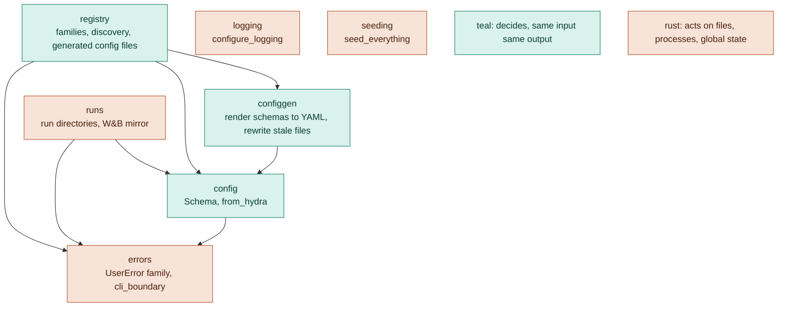

# Contributing

How nuikit is built and how to change it. Using it: [README.md](README.md). It follows the general rules of
[nuinashco/conventions](https://github.com/nuinashco/conventions), and [docs/guide.md](docs/guide.md) holds the rules
that name its API.

## Architecture



Dependencies point down. The import-linter layers contract in `pyproject.toml` enforces it and is exhaustive, so a
new module fails `make check` until it is placed: `registry`, then `configgen | runs`, then `config`, then
`errors | logging | seeding`. Modules in one layer never import each other. Heavy optional modules (`wandb`,
`torch`) are imported inside the function that needs them, so `import nuikit` stays cheap and the extras stay
optional.

## Repository layout

```text
src/nuikit/           the library, one module per concern; py.typed ships its types
tests/                one test module per library module; test_plugin.py renders the skill templates
docs/guide.md         FAM, CFG, ERR-1, ERR-2, LOG-1, LOG-3, RUN-1, RUN-2: the rules for code that uses nuikit
plugin/               the Claude Code plugin `nuikit`
  .claude-plugin/     plugin.json, without a version, so installs follow commits
  skills/<name>/      SKILL.md, plus templates/*.tmpl with <placeholders> to fill
.github/workflows/    ci.yml: `make check` on Python 3.12 and 3.14; release.yml: tags to PyPI
```

## Changing nuikit

- The public API is every module and name in README's table. Keep it stable: a rename or a changed signature is a
  breaking change, and until 1.0 a breaking change bumps the minor version (semver).
- A rule change edits `docs/guide.md`, the code and tests its *Check* names, and the skills that show the pattern,
  in the same commit. Keep the rule ID and never reuse a retired one.
- A change to what a skill template produces runs `make test`: `tests/test_plugin.py` renders the family templates
  into a package, registers it and runs the item's test template against it.
- `src/` passes pyright strict, `tests/` pyright standard; the floor is Python 3.12, so every module starts with
  `from __future__ import annotations` (TYP-3).

## Tests

```bash
make setup    # uv sync + pre-commit and commit-msg hooks
make test     # unit tests, under a second
make check    # ruff, import layers, pyright, pytest: what CI runs
```

Fakes, not mocks: `tests/test_runs.py` swaps `wandb` for an in-process fake module. Each case covers a distinct
behaviour, named as a sentence.

## Release

Tag a commit on `main` whose `pyproject.toml` has the same version: `git tag v0.2.0 && git push origin v0.2.0`.
`release.yml` refuses a tag that differs from `version`, then builds and publishes to PyPI. Projects move to it with
`uv lock --upgrade-package nuikit`, or by changing the tag in their `[tool.uv.sources]`.

## Deviations

- Tests sit at `tests/test_<module>.py`, not `tests/nuikit/test_<module>.py` (TST-4): with one package, the extra
  level would say nothing.
- The Makefile has no `configs` or `test-integration` target (LAY-6): nuikit has no configs and no end-to-end tests
  of its own; it adds `build`.

## Commits

Conventional Commits with the standard types (`feat fix docs refactor test build ci perf style chore revert`), an
optional scope, a lowercase imperative subject: one line, no articles, no body or trailers. Short-lived
`<type>/<slug>` branches, squash-merged; `make github` sets the repo up for that once. PR descriptions follow
`.github/pull_request_template.md`.
